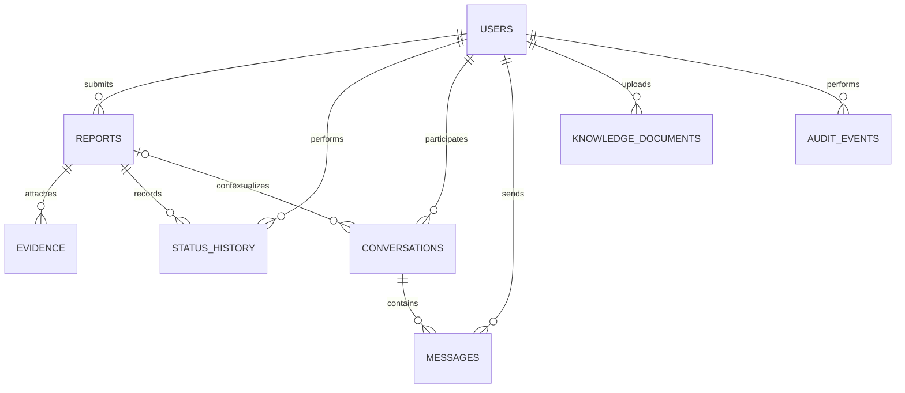

# SISKA — ERD dan Model Data

## 1. Catatan pemilihan penyimpanan
SISKA menggunakan **Firebase saja**: Firebase Authentication, Cloud Firestore, dan Cloud Storage. Supabase/PostgreSQL tidak termasuk arsitektur target. Firestore adalah document database sehingga tidak menggunakan SQL; file `03-DATABASE-SCHEMA.sql` hanya menjelaskan hal ini, sedangkan model kanonis ada di dokumen ini dan aturan/index ada di folder `firebase/`.

## 2. Entitas
- `users/{uid}`: profil aplikasi; UID berasal dari Firebase Auth. Role hanya diubah oleh admin tepercaya/custom claims.
- `reports/{reportId}`: laporan dengan `reporterId`, kategori, deskripsi, waktu/lokasi jika dibutuhkan, status, timestamps.
- `reports/{reportId}/evidence/{evidenceId}`: metadata file; file binary berada di Cloud Storage privat. Jangan simpan public URL permanen.
- `reports/{reportId}/statusHistory/{eventId}`: status lama/baru, actor UID, waktu, catatan minimum.
- `conversations/{conversationId}`: tipe `report_admin`, reporter UID, assigned admin UID, report ID opsional, status percakapan.
- `conversations/{conversationId}/messages/{messageId}`: sender UID, teks, timestamp, attachment metadata opsional.
- `knowledgeDocuments/{documentId}`: metadata PDF resmi, hash, uploader, status indexing, versi, timestamps.
- `knowledgeChunks/{chunkId}` atau vector index eksternal: teks chunk dan metadata sumber. Hindari menyimpan data kasus pribadi.
- `auditEvents/{eventId}`: aksi sensitif dan metadata minimal, tidak menyimpan payload laporan.

## 3. Relasi kardinalitas

## 4. Dokumen Firestore — field minimum
| Collection | Field utama | Catatan |
|---|---|---|
| users | uid, displayName, email, role, createdAt, updatedAt | email/identitas tidak boleh dipublikasikan |
| reports | reporterId, category, incidentAt?, location?, description, status, createdAt, updatedAt | deskripsi sangat sensitif; akses ketat |
| evidence subcollection | storagePath, originalName, contentType, sizeBytes, sha256?, uploadedBy, createdAt | tanpa public URL |
| statusHistory subcollection | fromStatus, toStatus, actorUid, note?, createdAt | append-only untuk client; server tepercaya menulis |
| conversations | reporterUid, adminUid?, reportId?, status, createdAt, updatedAt | akses dibatasi participant/claims |
| messages subcollection | senderUid, body, createdAt, attachmentPath? | jangan tampilkan ke nonparticipant |
| knowledgeDocuments | title, sourceUrl?, storagePath, sha256, uploadedBy, status, chunkCount, createdAt | hanya sumber disetujui |
| auditEvents | actorUid, action, targetType, targetId, occurredAt, requestId | retensi terbatas; akses admin terpilih |

## 5. Indeks Firestore yang kemungkinan dibutuhkan
- reports: `reporterId ASC, createdAt DESC`.
- reports: `status ASC, createdAt DESC` untuk dashboard admin.
- conversations: `reporterUid ASC, updatedAt DESC`.
- conversations: `adminUid ASC, updatedAt DESC`.
- messages subcollection: `createdAt ASC`.
- knowledgeDocuments: `status ASC, createdAt DESC`.

Validasi kebutuhan indeks berdasarkan query final; deploy indeks melalui `firestore.indexes.json` dan version control.

## 6. Integritas dan siklus hidup
- `reporterId` harus berasal dari sesi tepercaya, bukan nilai bebas dari request.
- Perubahan status dan statusHistory dilakukan dalam transaksi/server function agar konsisten.
- Metadata evidence ditulis setelah upload sukses; jika insert gagal, hapus file sebagai kompensasi.
- Penghapusan dokumen KB juga menghapus chunks/vector entries dan file storage melalui job terkontrol.
- Retensi laporan, bukti, pesan, dan audit harus disetujui institusi; jangan menghapus otomatis tanpa kebijakan tertulis.
