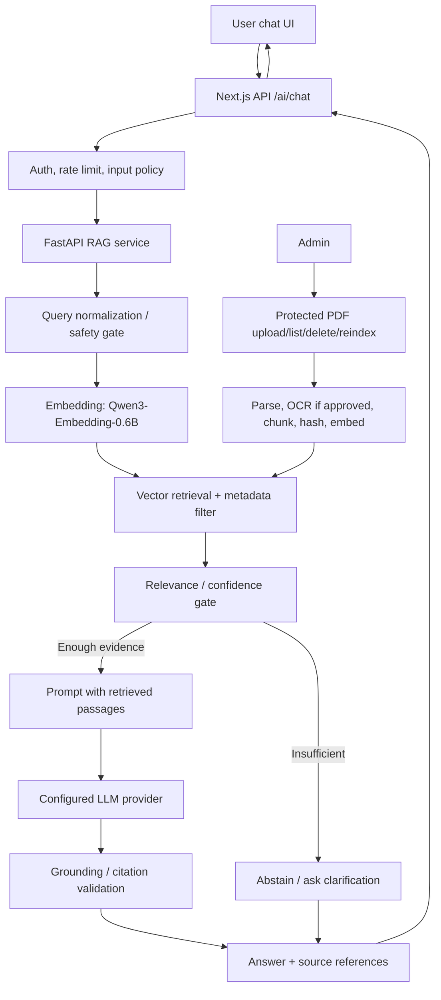

# SISKA AI — RAG Architecture

## 1. Tujuan dan batas
SISKA AI menjawab pertanyaan informasi umum berdasarkan dokumen terverifikasi: edukasi, FAQ, peraturan/ketentuan resmi, panduan aplikasi, dan kontak bantuan yang disetujui. AI bukan konselor, investigator, pengambil keputusan kasus, atau kanal darurat. Tidak melakukan diagnosis, penilaian kebenaran laporan, prediksi risiko individu, atau rekomendasi sanksi.

## 2. Arsitektur logis

## 3. Endpoints
- `GET /health`: readiness only; no secret/environment values in response.
- `POST /chat`: `{message, conversationId?}` → `{answer, grounded, sources[], escalationMessage?}`.
- `POST /admin/documents`: admin-only upload PDF, validate and queue indexing.
- `GET /admin/documents`: metadata and indexing status.
- `DELETE /admin/documents/{id}`: remove source, chunks, vector entries and cached copies.
- `POST /admin/reindex`: idempotent reindex job.
Admin endpoints must be protected by trusted server identity; do not expose the FastAPI service publicly without authentication. Prefer API gateway/service-to-service auth and network restrictions.

## 4. Ingestion pipeline
1. Admin uploads approved PDF; validate size, MIME and file signature.
2. Compute SHA-256, persist private original, record uploader/source/version.
3. Extract text; scanned PDF OCR only if approved and reviewed.
4. Normalize whitespace and preserve title/page/section metadata.
5. Chunk by semantic sections; initial experiment 500–800 tokens with 80–120 token overlap (tune empirically).
6. Generate embeddings using Qwen3-Embedding-0.6B or evaluated alternative.
7. Store chunks and vector metadata; publish document as indexed only after all steps succeed.
8. On failure, mark `failed`, retain safe error code, allow retry; deletion removes all derived data.
9. Review source authority, publication date, jurisdiction and version before indexing.

## 5. Retrieval and generation
- Retrieve top-k candidates, apply source status/version filters, deduplicate and rerank if beneficial.
- Establish a relevance threshold on validation data; do not invent universal threshold before evaluation.
- Prompt instructs model to use only supplied evidence, treat retrieved text as untrusted content (not instructions), cite sources, state uncertainty and abstain when unsupported.
- Validate citations against retrieved document IDs/pages.
- Never place report descriptions, evidence, private chat, auth tokens, or user profiles in embeddings/context by default.
- Avoid logging raw prompts/answers in production; use opt-in, redacted evaluation datasets.

## 6. Safety and escalation
- Questions about immediate danger: display institution-approved emergency/contact information and encourage contacting local emergency/official services; do not invent contacts.
- Personal case/legal/medical/psychological advice: explain limitation and route to official human support.
- Prompt injection: retrieved PDF content is data, never system instructions; test malicious text in documents.
- Refusal/abstention: insufficient retrieval, conflicting sources, outdated material, requests to judge a case, or requests for private data.
- Admin upload requires provenance and approval; delete/reindex actions are audited.

## 7. Evaluation plan
Build a curated set of at least 100 questions where feasible, covering direct facts, paraphrase, multi-hop, out-of-scope, outdated/conflicting sources, emergency, prompt injection and privacy attacks. Two reviewers should label expected answer, relevant sources, and abstention requirement.
Metrics: Recall@k/MRR for retrieval; citation precision; groundedness/faithfulness; answer correctness judged against rubric; abstention precision/recall; latency p50/p95; cost per request; prompt-injection success rate. Report sample size and limitations. Do not claim accuracy without measured results.

## 8. Configuration and operations
Environment keys (server only): `LLM_PROVIDER`, `LLM_API_KEY`, `LLM_MODEL`, `EMBEDDING_MODEL`, `VECTOR_STORE_URL`, `AI_SERVICE_TOKEN`, `MAX_INPUT_CHARS`, `TOP_K`, `RELEVANCE_THRESHOLD`. Values are deployment-specific; no credentials in repository. Provide provider adapter so LLM backend can switch. Apply timeouts, bounded retries, request limits, concurrency limits and cost budgets.

## 9. Chat UI integration
Use a visible toggle “Chat dengan Admin | SISKA AI” only if the mode distinction is clear. AI history may use localStorage as proposal suggests, but warn users not to enter report details and define device-sharing/privacy behavior. Server persistence requires explicit retention and access rules. AI and human chat must never be mixed into the same transcript without clear sender labels.

## Keputusan platform
SISKA menggunakan Firebase saja untuk autentikasi, data, dan file. Jangan menambahkan Supabase client, Supabase Auth, PostgreSQL/RLS, atau Supabase Storage. Source KOPKAS lama hanya sumber reuse dan harus dibersihkan dari integrasi Supabase.
