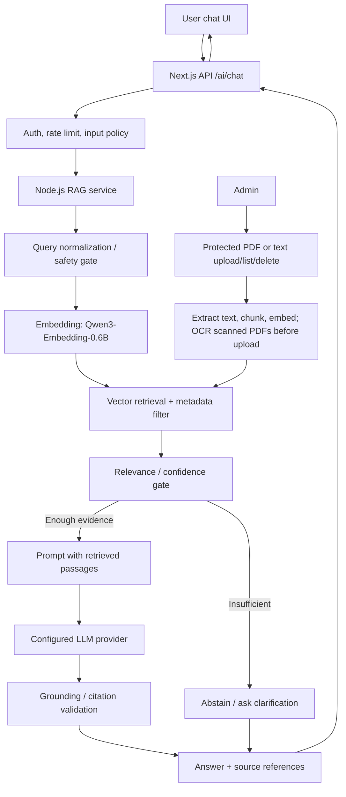

# SISKA AI — RAG Architecture

## 1. Tujuan dan batas
SISKA AI menjawab pertanyaan informasi umum berdasarkan dokumen terverifikasi: edukasi, FAQ, peraturan/ketentuan resmi, panduan aplikasi, dan kontak bantuan yang disetujui. AI bukan konselor, investigator, pengambil keputusan kasus, atau kanal darurat. Tidak melakukan diagnosis, penilaian kebenaran laporan, prediksi risiko individu, atau rekomendasi sanksi.

## 2. Arsitektur logis

## 3. Endpoints
- `GET /health`: readiness only; no secret/environment values in response.
- `POST /chat`: `{message, conversationId?}` → `{answer, grounded, sources[], escalationMessage?}`.
- SISKA exposes authenticated admin routes at `/api/v1/admin/ai-documents` for listing, adding, and deleting chat-RAG documents.
- The AI service exposes the corresponding server-to-server routes at `/admin/rag-docs`; they require `X-Service-Authorization`.
- Markdown/TXT content is chunked directly. Uploaded PDF text is extracted by the SISKA backend (25 MiB file and 300,000 extracted-character limits), then chunked and embedded by the AI service.
- Scanned/image-only PDFs require OCR and review before upload. The original PDF is not stored in the chat-RAG index; extracted text and embeddings are stored in the local export index.
- `/admin/reindex` reloads the current exported artifacts; it does not ingest PDFs from Firebase Storage.
- The Firebase Knowledge Base at `/api/v1/admin/knowledge-documents` is a separate pipeline and does not automatically add its PDFs to the chat-RAG index.
Admin endpoints must be protected by trusted server identity; do not expose the AI service publicly without authentication. Prefer API gateway/service-to-service auth and network restrictions.

## 4. Ingestion pipeline
1. Admin uploads an approved text-based PDF; the backend validates size, MIME and file signature.
2. Extract searchable text per page; scanned/image-only files are rejected until OCR is performed and reviewed.
3. Normalize whitespace and retain page headings in the extracted content.
4. Chunk the text and generate embeddings using the active embedding model.
5. Append chunks and vectors to the local RAG export index; the document becomes available to new chat requests.
6. On failure, return an explicit error and do not report the upload as successful; deletion removes the indexed chunks.
7. Review source authority, publication date, jurisdiction and version before indexing.

## 5. Retrieval and generation
- Retrieve top-k candidates, apply source status/version filters, deduplicate and rerank if beneficial.
- Establish a relevance threshold on validation data; do not invent universal threshold before evaluation.
- Prompt instructs model to use only supplied evidence, treat retrieved text as untrusted content (not instructions), cite sources, state uncertainty and abstain when unsupported.
- Validate citations against retrieved document IDs/pages.
- Never place report descriptions, evidence, private chat, auth tokens, or user profiles in embeddings/context by default.
- Avoid logging raw prompts/answers in production; use opt-in, redacted evaluation datasets.

## 6. Safety and escalation
- Questions about immediate danger: after prompt-injection and privacy checks, forward to the RAG service so institution-approved contacts can be returned with their source. If that service or its contact source is unavailable, give only general escalation guidance; never invent contacts or display an unconfigured placeholder.
- Personal case/legal/medical/psychological advice: explain limitation and route to official human support.
- Prompt injection: retrieved PDF content is data, never system instructions; test malicious text in documents.
- Refusal/abstention: insufficient retrieval, conflicting sources, outdated material, requests to judge a case, or requests for private data.
- Admin upload requires provenance and approval; delete/reindex actions are audited.

## 7. Evaluation plan
Build a curated set of at least 100 questions where feasible, covering direct facts, paraphrase, multi-hop, out-of-scope, outdated/conflicting sources, emergency, prompt injection and privacy attacks. Two reviewers should label expected answer, relevant sources, and abstention requirement.
Metrics: Recall@k/MRR for retrieval; citation precision; groundedness/faithfulness; answer correctness judged against rubric; abstention precision/recall; latency p50/p95; cost per request; prompt-injection success rate. Report sample size and limitations. Do not claim accuracy without measured results.

## 8. Configuration and operations
Environment keys (server only): `LLM_PROVIDER`, `LLM_API_KEY`, `LLM_MODEL`, `EMBEDDING_MODEL`, `VECTOR_STORE_URL`, `AI_SERVICE_TOKEN`, `MAX_INPUT_CHARS`, `TOP_K`, `RELEVANCE_THRESHOLD`. Values are deployment-specific; no credentials in repository. Provide provider adapter so LLM backend can switch. Apply timeouts, bounded retries, request limits, concurrency limits and cost budgets.

## 9. Chat UI integration
Use a visible toggle “Chat dengan Admin | SISKA AI” only if the mode distinction is clear. The AI transcript and conversation ID are retained in `sessionStorage`, scoped by authenticated user, so navigation within the same browser tab preserves the conversation; closing the tab clears it. This is client-side display/context continuity, not server-side history. Warn users not to enter report details and define device-sharing/privacy behavior. Server persistence requires explicit retention and access rules. AI and human chat must never be mixed into the same transcript without clear sender labels.

## Keputusan platform
SISKA menggunakan Firebase saja untuk autentikasi, data, dan file. Jangan menambahkan Supabase client, Supabase Auth, PostgreSQL/RLS, atau Supabase Storage. Source KOPKAS lama hanya sumber reuse dan harus dibersihkan dari integrasi Supabase.
